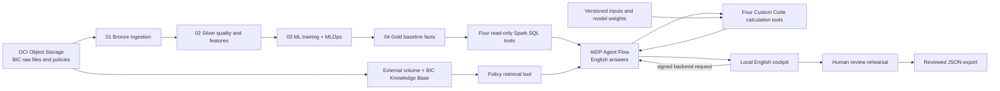

# Architecture and responsibilities

All source data enters from the specified Object Storage prefix. Bronze, Silver and Gold tables are AIDP managed Delta tables. The cockpit uses exported Gold model weights and the same numerical implementation to simulate immediately; the deployed agent invokes Python tools to recalculate the current scenario and candidate remedies during the question.

## ML versus agent

The logistic model predicts the probability of at least one incomplete order line within seven days. The log-linear model predicts weekly demand. A firm-order floor is then applied; a deterministic daily planning profile distributes the weekly total. It is not a separate daily ML model.

The numerical tools calculate available stock by date, peak uncovered demand, shipping multiples, incremental freight and rule status. The agent retrieves evidence in response to the user's question, explains the operational event, compares remedies and articulates the next decision. It cannot invent stock or change a blocked policy.

No scenario grid, alternatives or recommendations are used as answer lookups. Four Custom Code tools calculate the scenario, transfer, acceleration and split-delivery impact on demand. The agent chooses which tools and candidate quantities to evaluate, compares the returned results and recommends an eligible option for review. Supported action families and business formulas are predefined; the numerical alternatives and recommendation are produced during the interaction.

The tool package contains a versioned copy of the Object Storage source inputs, policies and exported model weights. It validates input hashes on each execution. This is a cached input snapshot, not a live ERP or Object Storage read on every question. Rebuild and redeploy the package after changing the source snapshot or model. Legacy scenario/option tables from the previous prototype are retained unused; no agent tool reads them and notebook 04 no longer generates them.

## Runtime boundary

The browser calls a loopback backend. OCI CLI signs calls to the BIC-only agent endpoint; credentials never reach JavaScript. Agent output is a JSON contract. A mismatch between the returned scenario hash and the active sliders prevents solution tiles from being applied.

The app reveals solutions only after a remedy question and successful calculation calls. Each tool returns a UUID, timestamp, scenario hash and result hash; the agent copies these receipts. The backend checks the actual tool trace and independently recalculates the result from the same inputs. Trace outputs are redacted by the platform, so this is a numerical consistency check plus evidence of invocation, not cryptographic attestation of each tool argument. No generic option is substituted when a receipt is absent or invalid.

A proposal ID binds validation to the evaluated alternatives and active scenario. A simulation change requires fresh calculations. Proposals are session-scoped; after a server restart, ask again before preparing or continuing approval. Each option exposes PASS, BLOCKED and REVIEW policy results. A selected option creates a frozen local decision record with explicit role approvals and an audit history. A blocked option is escalated; escalation does not approve an exception. JSON export becomes available only after all required roles have approved.

This workflow is a demonstration application feature, not a claim that production role separation or a durable enterprise workflow has been deployed. Production needs authenticated approvers, managed persistence, concurrency control, ERP idempotency and downstream acknowledgements.

## Target JDE context

A future design could ingest JDE order, allocation, receipt and commercial data into the platform and send approved requests through a configured EnterpriseOne Orchestrator workflow. Field mapping, version availability, authorization, conflict handling and transaction acknowledgements require validation with the customer's JDE team. This package neither connects to nor emulates a live JDE instance.

## Implementation references

- Oracle AIDP Agent Flow tools: https://docs.oracle.com/en/cloud/paas/ai-data-platform/aidug/agent-flow-tools.html
- Oracle custom tool authoring guide: https://github.com/oracle-samples/oracle-aidp-samples/blob/main/ai/agent-flows/custom-tools/USER_GUIDE.md

The ZIP and tool configuration in this package were executed in the specified AIDP workspace; another environment must verify its available compute and API version.
